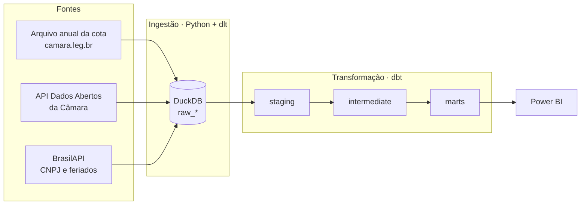

# Para onde vai o dinheiro da cota parlamentar?

Projeto de analytics engineering, da ingestão ao painel, sobre a **Cota para o Exercício da Atividade Parlamentar (CEAP)**: a verba mensal que cada deputado federal usa para gastos do mandato (passagens, combustível, escritório, divulgação…). São cerca de R$ 200 milhões por ano, com nota fiscal pública.

A pergunta: **quem gasta fora do padrão, e com quais fornecedores?** Os sinais procurados são os que um analista de controle externo usaria:

- empresa aberta poucos dias antes de receber o primeiro pagamento;
- ramo de atividade (CNAE) do fornecedor incompatível com o tipo de despesa;
- fornecedor que vive de um único deputado;
- gasto em fim de semana ou feriado, nota repetida;
- deputado muito acima dos colegas do mesmo estado (o teto da cota varia por UF).

> Sinal não é acusação: o projeto aponta onde olhar, não conclui irregularidade.

## Arquitetura



| Camada | Ferramenta | Por quê |
|---|---|---|
| Ingestão | [dlt](https://dlthub.com) | Paginação, retry com `Retry-After`, carga incremental e evolução de schema sem código de infraestrutura |
| Armazenamento | DuckDB | Banco analítico num arquivo: qualquer pessoa clona e roda, sem conta em nuvem |
| Transformação | dbt-core | Camadas, testes, documentação e linhagem |
| Consumo | Power BI | Painel final |
| Orquestração | GitHub Actions | Atualização agendada e CI sem servidor |

## Como rodar

Pré-requisito: [uv](https://docs.astral.sh/uv/).

```bash
uv sync
uv run python -m ingestion.pipeline             # carga completa: 2023–2026 + 500 CNPJs
uv run python -m ingestion.pipeline --anos 2026 # só atualiza o ano corrente
```

O consumo de CNPJ na BrasilAPI é limitado por execução (`--limite-cnpj`), dos fornecedores que mais receberam primeiro. Execuções seguintes continuam de onde pararam.

## Decisões

As escolhas que não são óbvias ficam registradas, com a evidência:

- [001 — Despesas vêm do arquivo anual, não do endpoint da API](docs/decisoes/001-despesas-do-arquivo-anual.md)

## Status

- [x] Ingestão
- [ ] Staging
- [ ] Intermediate (SCD2 de partido, cruzamento com a Receita, sinais de anomalia)
- [ ] Marts
- [ ] Painel no Power BI
- [ ] Agendamento e CI
